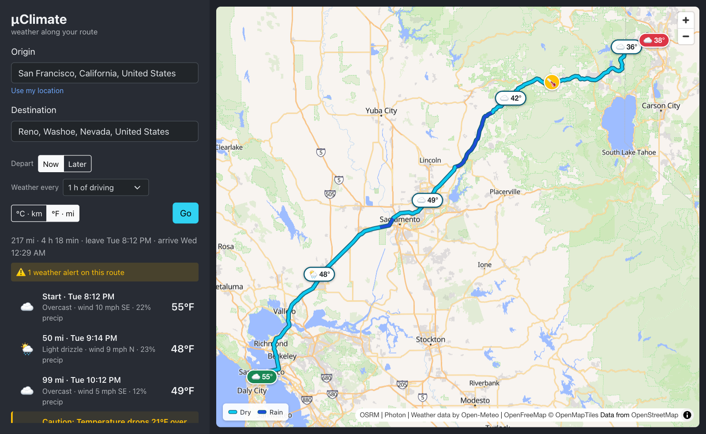
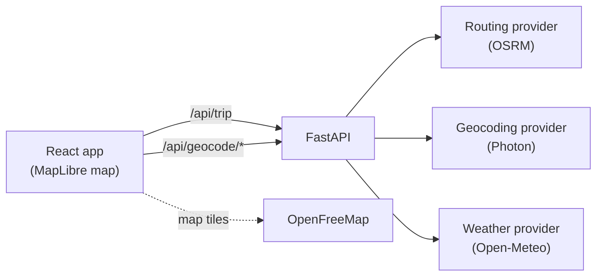

# μClimate

**Weather along your route.** Pick a start and a destination; μClimate plans the drive and shows
the forecast at points along the way, timed to when you'll actually be there.



## Features

- Driving route between any two places, worldwide
- Leave now or pick a departure time up to a week ahead
- Weather stops every 30 min to 3 h of driving (your choice), each with its own arrival time
- Hazard alerts (storms, snow, freezing rain, heavy rain, fog, strong gusts, sharp temperature
  swings), checked about every 10 km so nothing hides between stops
- Route line colored by the conditions you'll drive through
- The forecast hour that matches your ETA at each stop: conditions, temperature, wind, and chance of precipitation
- Search-as-you-type for places, plus "use my location"
- Metric or imperial units, defaulting to your browser's locale
- No API keys or accounts needed: everything runs on free, open data

## Tech stack

| Layer    | Technology |
| -------- | ---------- |
| Frontend | React 18, TypeScript, Vite, React-Bootstrap, MapLibre GL (via `react-map-gl`) |
| Backend  | Python 3.12, FastAPI, httpx, pydantic |
| Map      | [OpenFreeMap](https://openfreemap.org/) vector tiles ([OpenStreetMap](https://www.openstreetmap.org/) data) |
| Routing  | [OSRM](https://project-osrm.org/) |
| Search   | [Photon](https://photon.komoot.io/) (OpenStreetMap geocoder) |
| Weather  | [Open-Meteo](https://open-meteo.com/) |
| Tests    | pytest + respx, Vitest + Testing Library |

## Quick start

Prerequisites: **Node.js 20+**, **Python 3.12+**, and [**uv**](https://docs.astral.sh/uv/).

```bash
npm run setup   # installs root, client, and backend dependencies
npm run dev     # API on :4200, web app on :5173
```

Open <http://localhost:5173>. Interactive API docs are at <http://localhost:4200/docs>.

Other scripts (run from the repo root):

| Command           | What it does |
| ----------------- | ------------ |
| `npm test`        | Backend and frontend test suites (no network needed) |
| `npm run check`   | Lint, format check, and type-check both halves |
| `npm run build`   | Production build of the web app (`client/dist`) |
| `npm run gen:api` | Regenerate the client's API types from the running backend |

## Configuration

Nothing needs configuring to run locally. To override defaults, copy `backend/sample.env` to
`backend/.env` (and optionally `client/sample.env` to `client/.env.local`).

| Variable             | Default                           | Purpose |
| -------------------- | --------------------------------- | ------- |
| `OSRM_URL`           | `https://router.project-osrm.org` | Routing server |
| `PHOTON_URL`         | `https://photon.komoot.io`        | Geocoding server |
| `OPEN_METEO_URL`     | `https://api.open-meteo.com`      | Weather API |
| `TRACK_INTERVAL_KM`  | `10`                              | Spacing of the points checked for hazards |
| `MAX_TRACK_POINTS`   | `200`                             | Upper bound on those points (spacing widens on long routes) |
| `MAX_STOPS`          | `40`                              | Upper bound on stops listed per trip |
| `CORS_ORIGINS`       | *(empty)*                         | Comma-separated origins allowed to call the API cross-origin |
| `VITE_API_URL`       | same origin                       | (client) API location |
| `VITE_MAP_STYLE`     | OpenFreeMap "liberty"             | (client) MapLibre style URL |

## How it works



A trip request goes through these steps:

1. The backend asks OSRM for the route, including the driving time of every segment.
2. It walks the route and places a track point every `TRACK_INTERVAL_KM`. Each point's ETA is the summed segment times up to that point.
3. It fetches the hourly forecast for all track points in **one** batched Open-Meteo request (only as many days as the drive needs), and picks the hour closest to each point's ETA.
4. Every track point is checked for hazards. Consecutive hazardous points are merged into alerts, and the points drive the route's colors.
5. The stops listed for the user are the track points nearest each `interval_min` of driving. The interval only affects that list, never which hazards are found.

Each external service sits behind a small interface in
[`backend/app/providers/`](backend/app/providers/), so it can be swapped through config.

### Adding another API

1. Add a module under `backend/app/providers/`. If you might want alternatives later, define a `Protocol` for it in `base.py`.
2. Expose it through a router in `backend/app/routers/`, with pydantic response models in `models.py`.
3. Put any keys or URLs in `Settings` (`backend/app/config.py`). Secrets stay on the server.
4. Run `npm run gen:api` so the client picks up the new, typed endpoint.

### Heavier use

The default OSRM and Photon servers are public demo instances meant for light use. For anything
busier, self-host them (both ship Docker images) and point `OSRM_URL` and `PHOTON_URL` at your
instances. Open-Meteo's free API is for non-commercial use; commercial use needs one of their
[API plans](https://open-meteo.com/en/pricing).

## Project layout

```text
backend/   FastAPI service (see backend/README.md)
client/    React + Vite web app (see client/README.md)
images/    README assets
```

## Credits

Created by **Michael Ruiz**.

### Data and attribution

- Map data © [OpenStreetMap contributors](https://www.openstreetmap.org/copyright), available under the ODbL
- Map tiles by [OpenFreeMap](https://openfreemap.org/), using the [OpenMapTiles](https://openmaptiles.org/) schema
- Routing by [OSRM](https://project-osrm.org/)
- Place search by [Photon](https://photon.komoot.io/) from komoot
- [Weather data by Open-Meteo.com](https://open-meteo.com/), licensed under CC BY 4.0

## License

[MIT](LICENSE) © 2022 Michael Ruiz
